# Nmap Scan Detection & Packet Analysis Using Wireshark

**By:** Rania Mattar
**Tools:** Wireshark, Kali Linux
**Data source:** Official Wireshark sample captures (NMap-Captures.zip, wiki.wireshark.org/SampleCaptures)

## 1. Introduction

For this project I wanted to look at Nmap scanning from the other side — not running the scans myself, but analyzing pre-recorded packet captures of different Nmap scan techniques to see what a defender could actually tell just from the raw traffic. This connects to my Digital Forensics coursework (network traffic analysis) as well as what I learned about Nmap in my first project.

The question I set out to answer: **can different Nmap scanning techniques be identified from packet-level evidence alone, and where does the evidence run out?**

## 2. Dataset

I downloaded `NMap-Captures.zip` from Wireshark's official sample captures page and extracted it in a Kali Linux terminal:

```bash
cd ~/Downloads
unzip NMap-Captures.zip
ls -lh
```

This produced five capture files, each showing a different Nmap scan technique:

- `nmap_standard_scan`
- `nmap_ACK_scan_on_port_80`
- `nmap_OS_scan`
- `nmap_OS_scan_successful`
- `nmap_zombie_scan`

The terminal was only used to extract the files — all the actual analysis was done in Wireshark.

## 3. Methodology

For each capture, I used Wireshark's **Statistics > Conversations**, **Statistics > Protocol Hierarchy**, and specific TCP flag filters (e.g. `tcp.flags.syn == 1 && tcp.flags.ack == 0`) to identify:

- who was talking to whom
- what kind of probes were being sent
- what responses (if any) came back
- what that combination suggests about the scan type

I was careful to only report what the packets actually showed, and to say clearly when the capture didn't have enough information to support a stronger conclusion.

## 4. Results

### 4.1 Standard scan (`nmap_standard_scan`)

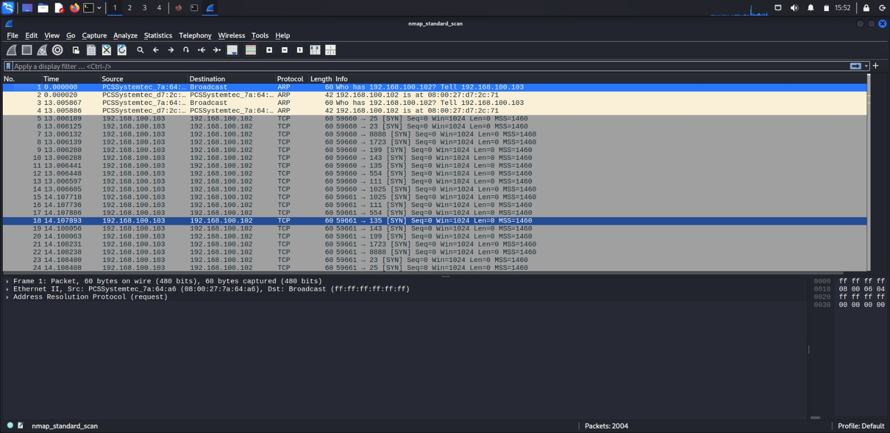

- Total packets: 2004 (2000 TCP, 4 ARP)
- Conversations: 2000 packets A→B, **0 packets B→A**

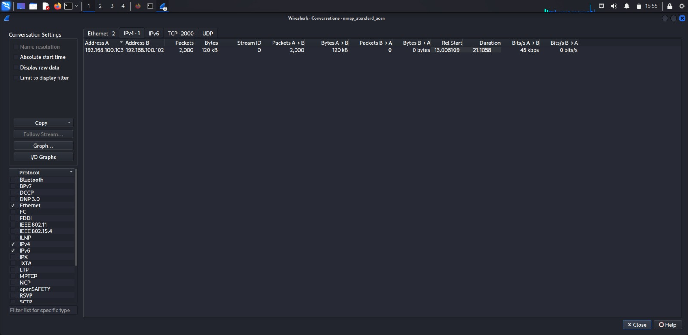

- Filter `tcp.flags.syn == 1 && tcp.flags.ack == 0` → 2000 packets (all outbound SYN probes)

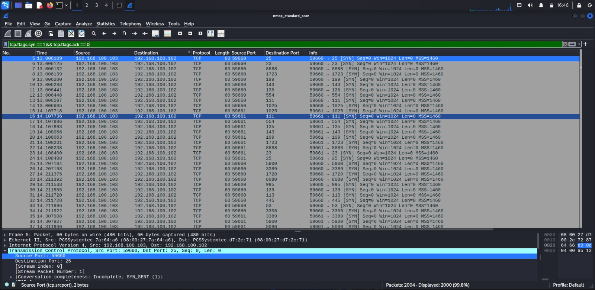
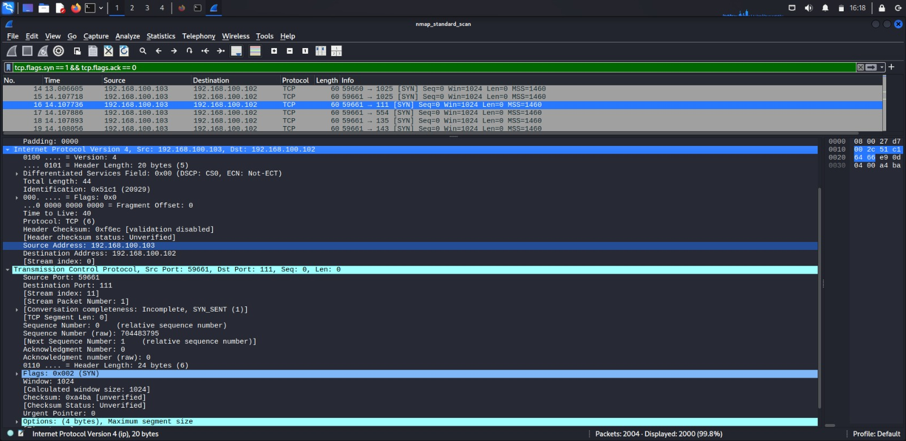

- Filter `tcp.flags.reset == 1` → 0 packets

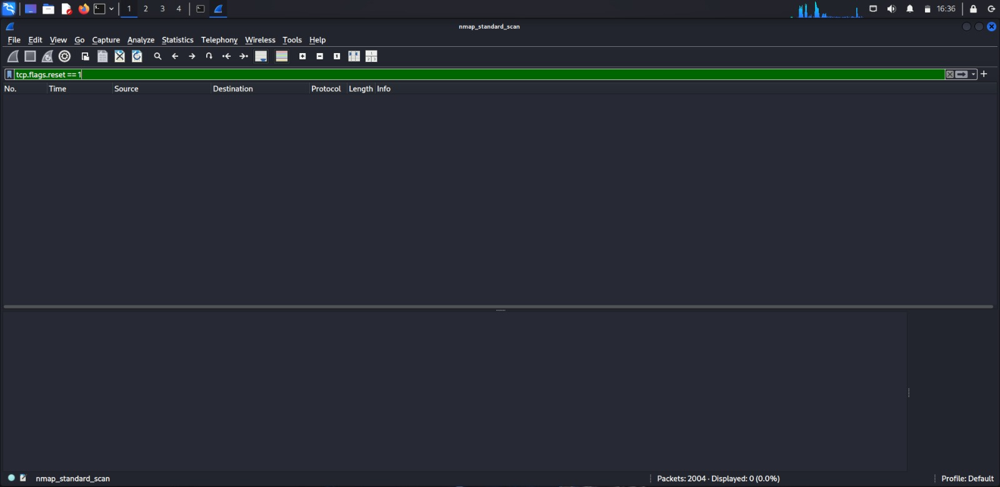

- Filter `tcp.flags.syn == 1 && tcp.flags.ack == 1` → 0 packets

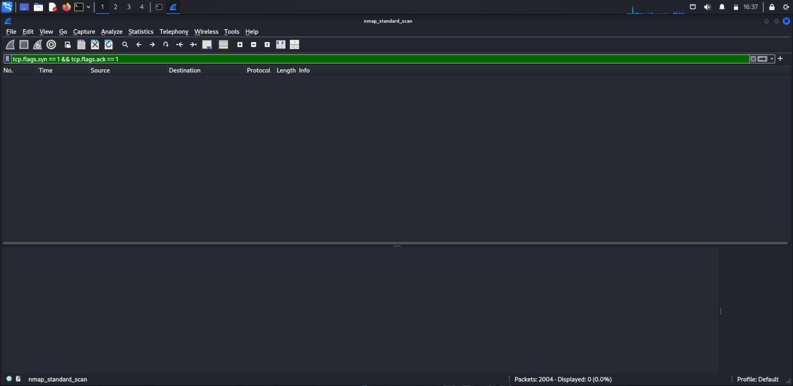

- Filter `tcp.flags.ack == 1` → 0 packets

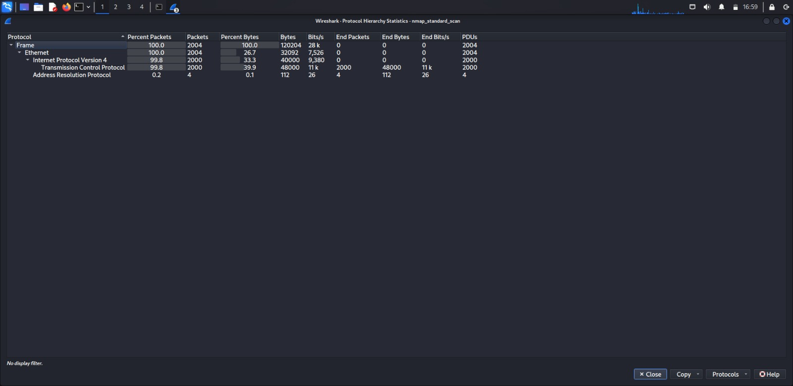

**Finding:** This capture contains 2,000 outbound TCP SYN probes with no response traffic at all (no SYN-ACK, no RST). This is consistent with a standard TCP SYN scan, but because no responses were captured, I cannot determine which ports were actually open, closed, or filtered from this file alone — that information simply isn't present in the capture.

### 4.2 ACK scan (`nmap_ACK_scan_on_port_80`)

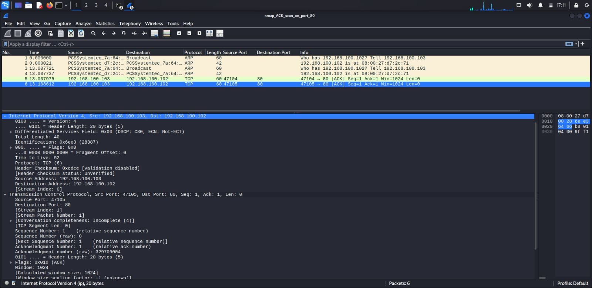
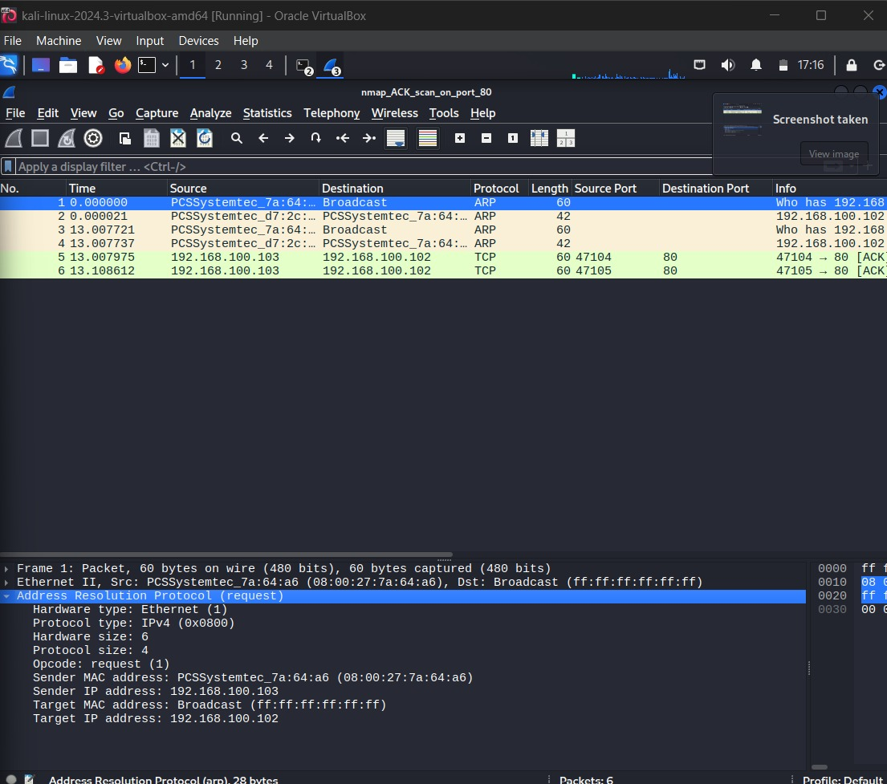

- Total packets: 6 (2 TCP, 4 ARP)
- Source: `192.168.100.103`, Target: `192.168.100.102:80`
- Two ACK packets, from source ports 47104 and 47105, both directed at port 80
- Filter `tcp.flags.ack == 1` → 2 packets
- No response traffic from the target present

**Finding:** The capture shows two ACK probes sent to port 80, consistent with an ACK scan (used by Nmap mainly for firewall/filtering detection, not for determining open/closed state). No response from the target is present, so I can't say how the target reacted.

### 4.3 OS scan (`nmap_OS_scan`)

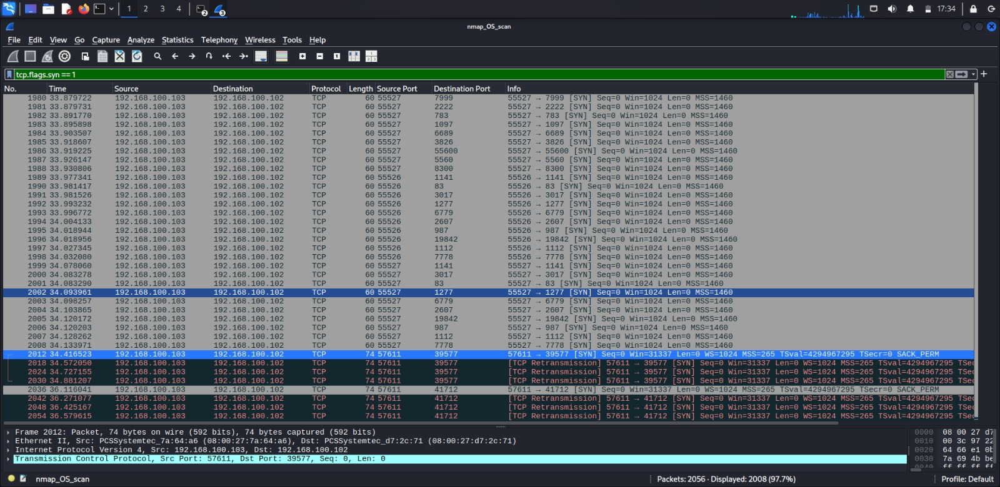

- Total packets: 2056 (2024 TCP, 16 ICMP, 6 ARP)
- Filter `tcp.flags.syn == 1` → 2008 packets
- Filter `tcp && !(tcp.flags.syn == 1)` → 16 packets, showing a mix of ACK, FIN, and FIN-PSH-URG flag combinations

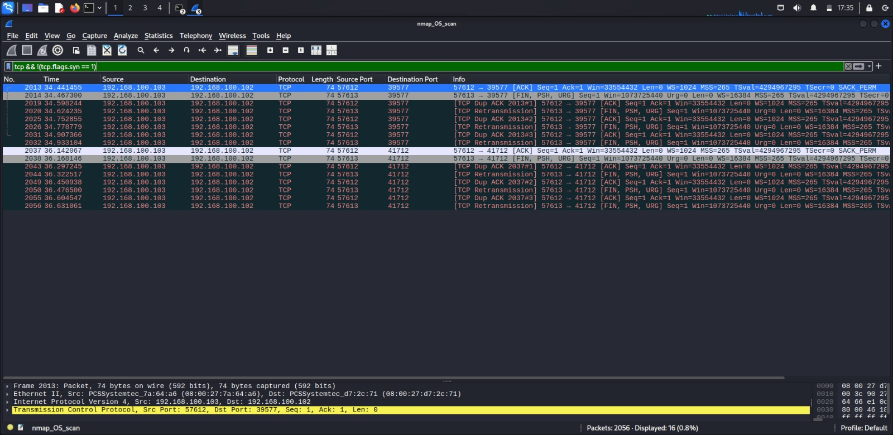
  - 8 packets matched `tcp.flags.ack == 1 && tcp.flags.syn == 0`
  - 8 packets matched `tcp.flags.fin == 1`
- These non-standard probes were directed at specific ports (39577, 41712) rather than spread across many ports

**Finding:** This capture contains a large number of ordinary SYN probes plus a small, deliberately varied set of non-SYN probes (different flag combinations aimed at specific ports). This pattern is consistent with OS fingerprinting behavior, since fingerprinting relies on sending unusual packets to see how a target's TCP/IP stack reacts. The capture does not include any response traffic, so it does not provide enough evidence to name a specific operating system.

### 4.4 Successful OS scan (`nmap_OS_scan_successful`)

- Total: 2052 packets (2048 TCP, 4 ARP — following the same pattern as the other captures)
- Filter `tcp.flags.syn == 1 && tcp.flags.ack == 0` → 2007 packets (SYN probes)
- Filter `tcp.flags.syn == 1 && tcp.flags.ack == 1` → 10 packets (SYN-ACK responses)
- Filter `tcp && ip.src == 192.168.100.101` → 19 packets, showing the full set of responses actually sent back by the target: a mix of SYN-ACK, RST-ACK, and RST flags
- Example response: `192.168.100.101:445` → `192.168.100.103:44276`, flags SYN-ACK

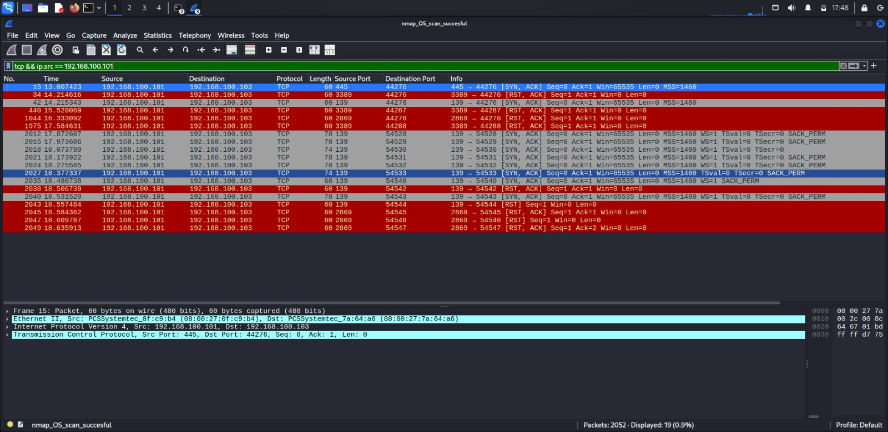

**Finding:** This capture is meaningfully different from the plain OS scan file — it contains real responses from the target (SYN-ACK, RST-ACK, RST). This kind of response diversity is what Nmap's OS-fingerprinting logic relies on to guess an operating system. The capture does not provide enough information for me to determine a specific OS myself, since I have not studied Nmap's fingerprinting database in that depth — I'm reporting what evidence is present, not reproducing Nmap's own conclusion.

### 4.5 Zombie / idle scan (`nmap_zombie_scan`)

- Total packets: 42 (36 TCP, 6 ARP)
- Two TCP conversations:
  - `192.168.100.102 ↔ 192.168.100.101`: 10 total (4 A→B, 6 B→A)
  - `192.168.100.103 ↔ 192.168.100.101`: 26 total (13 A→B, 13 B→A)

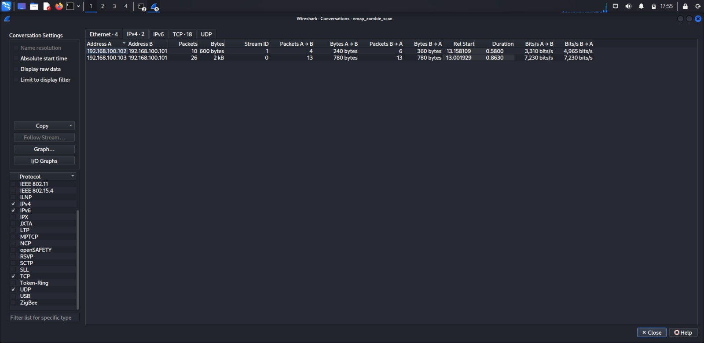

- Three hosts involved: `.101`, `.102`, `.103` — this is consistent with the three-party structure expected of an idle/zombie scan (attacker, zombie, target)
- TCP flags observed: SYN-ACK, RST

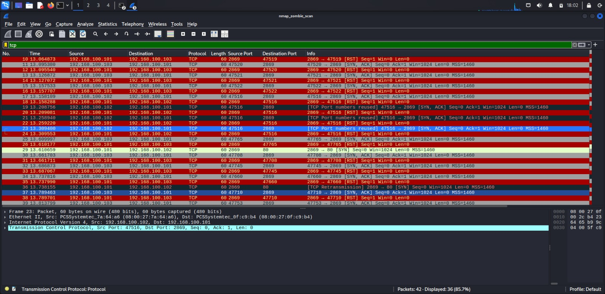

- I checked the IP Identification (IP ID) field for `192.168.100.102`, since idle scans rely on the "zombie" host having predictable, sequential IP IDs. Observed values: 30634, 55698, 16518, 46115 — these are **not sequential**.

**Finding:** The three-host traffic pattern is consistent with the structure of a zombie/idle scan. However, the IP ID evidence does not support identifying `.102` (or any host) as the confirmed zombie — the values checked were not sequential, so the capture does not provide enough evidence to determine which host played that role. I'm recording this as an open observation rather than a confirmed finding.

## 5. Comparison Across Scans

The table below compares what each capture's traffic actually looked like — not which scan was "better," but how each technique's packet behavior differed.

| Scan | Total Packets | Response Traffic Present? | Observed Packet Behavior |
|---|---|---|---|
| Standard | 2004 | No | Pure outbound SYN probing across many ports; no reply traffic |
| ACK | 6 | No | Two ACK probes to a single port (80); no reply traffic |
| OS scan | 2056 | No (16 ICMP packets present, no TCP replies) | SYN probes plus a small set of non-standard TCP flag combinations aimed at specific ports |
| OS scan (successful) | 2052 | Yes (SYN-ACK, RST-ACK, RST) | Same probe style as above, but target responses are present in this capture |
| Zombie scan | 42 | Yes (partial, between three hosts) | Three-host traffic pattern; IP ID values checked were not sequential |

## 6. Limitations

Three of the five captures (standard scan, ACK scan, and the plain OS scan) contain little to no response traffic from the target. This means that for those three, I can describe what the scanner sent, but I cannot determine the target's actual port states or behavior — that information is simply not present in the file. The successful OS scan and the zombie scan both contain two-way traffic, which is what allowed a fuller analysis in those sections. I've treated the absence of response data as a real limitation of the evidence rather than something to guess around.

## 7. Conclusion

This project showed that different Nmap scanning techniques leave distinct, recognizable patterns at the packet level — a pure SYN flood, a small pair of ACK probes, a mix of unusual flag combinations for OS fingerprinting, or a three-host relationship for an idle scan. But the strength of any conclusion depended heavily on how much of the traffic was actually captured: with response data present (as in the successful OS scan), I could describe real target behavior; without it (as in three of the five captures), I could only describe what was sent, not what happened as a result. The main takeaway is that packet-level evidence can distinguish between different Nmap scanning behaviors, but the amount and direction of captured traffic directly determines how confidently an investigator can identify the scan and its effects — and being honest about that boundary was as much a part of this project as identifying the scans themselves.

## 8. What This Means for Defense

Based only on these patterns, a defender monitoring network traffic could look for:

- A single source IP generating a large burst of SYN packets to many different destination ports in a short time (standard scan pattern).
- ACK packets arriving without any prior SYN from that source (a sign of ACK-based firewall probing).
- Unusual, non-standard TCP flag combinations aimed at a small number of ports (possible OS fingerprinting).
- Traffic patterns involving a third host relaying probes indirectly (possible idle/zombie scan).

## Evidence

See `screenshots/` for the packet-level evidence supporting each finding above, and `evidence/findings.txt` for a plain-text summary of the key numbers.
